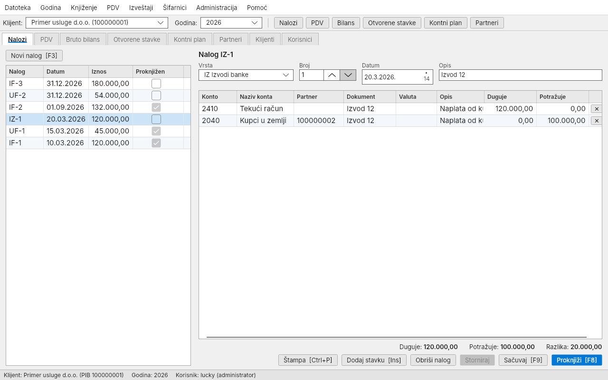
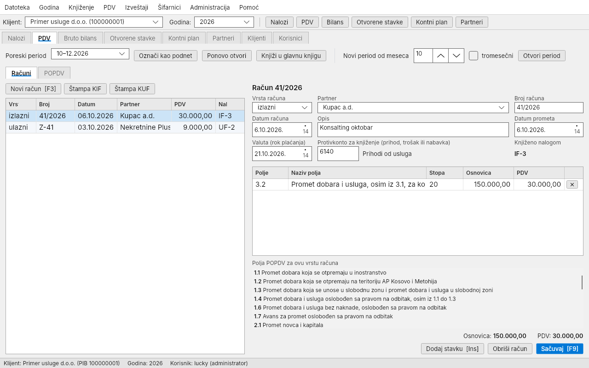
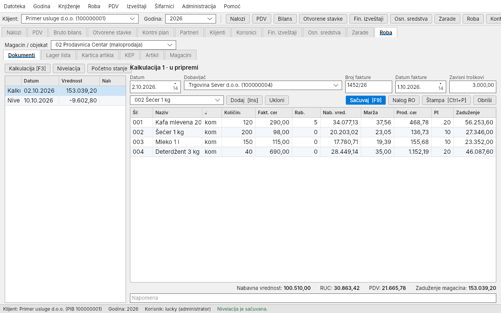
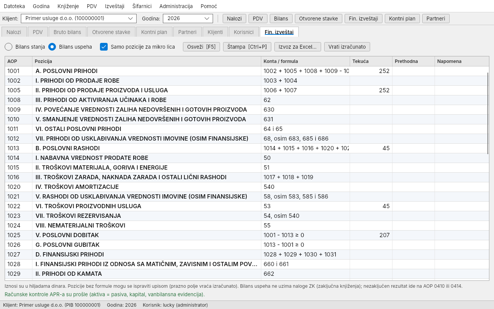
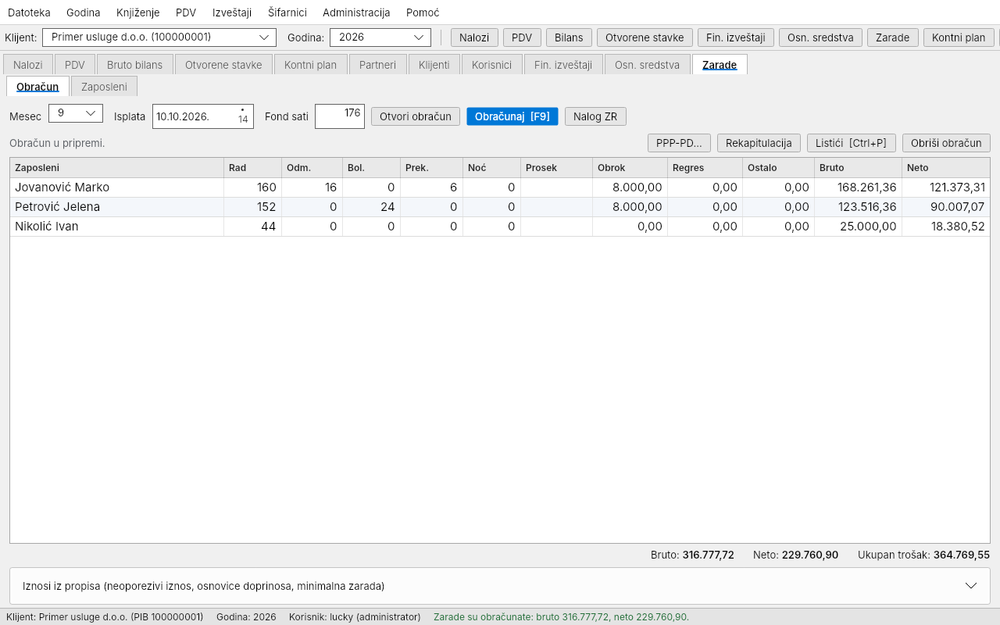
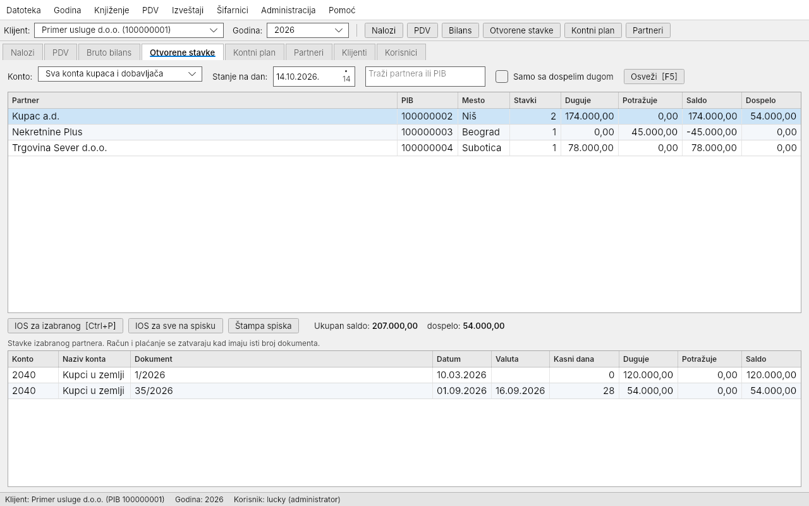
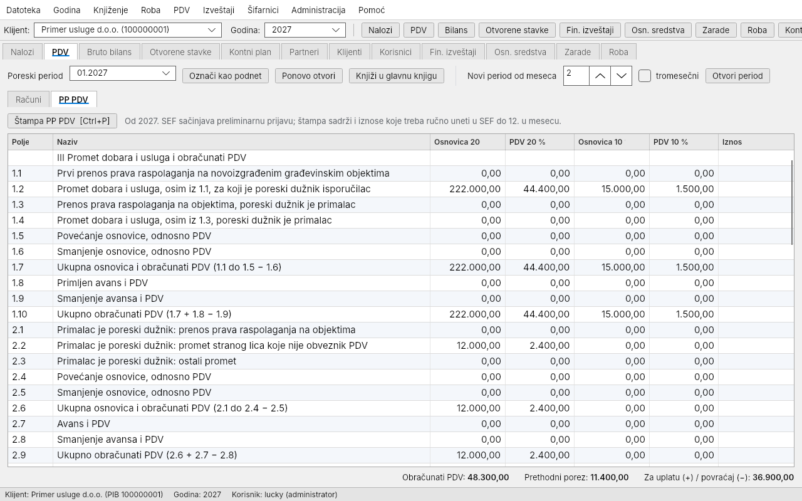

# Knjigovođa

**Desktop program za knjigovodstvene agencije u Srbiji.** Jedna kancelarija vodi knjige za više klijenata
(preduzeća, veleprodaje, maloprodaje), po poslovnim godinama, na više računara koji rade nad jednom zajedničkom
bazom. Program prati važeće propise (kontni okvir 2020, POPDV do kraja 2026. i PP PDV od 2027, obrasci APR-a,
PPP-PD, SEF e-fakture) i sam se ažurira kada izađe nova verzija.

**[⬇ Preuzmi program za Windows](https://github.com/aluckyv/Knjigovodja-izdanja/releases/latest/download/Knjigovodja-win-Setup.exe)**
· [Sva izdanja](https://github.com/aluckyv/Knjigovodja-izdanja/releases)
· [Rad na više računara](rad-u-mrezi.md)

## Kome je namenjen

- **Knjigovodstvenim agencijama** sa više računara u kancelariji: baza je na jednom računaru (serveru), ostali se
  povezuju preko lokalne mreže. Svaki korisnik ima svoj nalog, a izmene se beleže.
- **Klijentima svih vrsta**: usluge, veleprodaja i maloprodaja. Roba, fakture i dnevni promet prodavnica vode se
  u samom programu.
- **Knjigovođama koji rade tastaturom**: klasičan izgled sa menijem, gustim tabelama i prečicama
  (F3 novo, Ins stavka, F9 sačuvaj, F8 proknjiži, Ctrl+P štampa).

## Šta program radi

| Oblast | Šta sadrži |
|---|---|
| **Glavna knjiga** | Nalozi za knjiženje sa knjiženjem i stornom, kontni plan (kontni okvir 2020), partneri, bruto bilans, kartica konta, prenos početnog stanja, zaključna knjiženja, mesta troškova |
| **Kupci i dobavljači** | Otvorene stavke i IOS, uvoz izvoda banke, devizni kupci i dobavljači sa kursnim razlikama, kompenzacije i cesije, zatezna kamata |
| **PDV** | KIF/KUF po poljima POPDV, knjiženje računa u glavnu knjigu, PP PDV od 2027, avansi sa PDV-om, zaključavanje predatog perioda |
| **SEF e-fakture** | Preuzimanje ulaznih i izlaznih faktura i slanje faktura kupcima |
| **Robno knjigovodstvo** | Magacini i prodavnice, kalkulacije (i uvozne), nivelacije, lager lista, KEP, fakture i otpremnice, prenos, dnevni promet fiskalne kase, popis, automatski nalog za knjiženje |
| **Blagajna** | Blagajnički izveštaj, uplatnice i isplatnice |
| **Zarade i isplate** | Obračun zarada i PPP-PD, ugovor o delu, autorski honorar, zakup, putni nalozi i dnevnice |
| **Osnovna sredstva** | Registar, amortizacija, poreska amortizacija, isknjiženje |
| **Završni račun** | Bilans stanja i bilans uspeha po obrascima APR-a, poreski bilans i porez na dobit |
| **Sigurnost podataka** | Proknjižen nalog se ispravlja samo stornom, zaključena godina se ne menja, dnevna rezervna kopija na svakom računaru |
| **Štampa** | PDF za naloge, bilanse, kartice, KIF/KUF, POPDV/PP PDV, IOS, fakture, kalkulacije, obračune i obrasce |

## Izgled

| | |
|---|---|
|  |  |
| PDV evidencija po poljima POPDV | Kalkulacija u maloprodaji |
|  |  |
| Bilans stanja i uspeha (APR) | Obračun zarada |
|  |  |
| Otvorene stavke i IOS | PP PDV od 2027. |

Snimci su napravljeni sa probnim podacima.

## Kako početi

1. Na računaru koji drži bazu instalirajte [PostgreSQL 16](https://www.postgresql.org/download/windows/) i zapamtite lozinku.
2. Na svakom računaru pokrenite [Knjigovodja-win-Setup.exe](https://github.com/aluckyv/Knjigovodja-izdanja/releases/latest/download/Knjigovodja-win-Setup.exe).
   Instalira se bez administratorskih prava. Windows može prikazati upozorenje SmartScreen jer instalacija nije
   potpisana: kliknite „More info” → „Run anyway”.
3. Pri prvoj prijavi unesite adresu servera i lozinku baze, pa korisničko ime i lozinku: taj korisnik postaje
   administrator. Program sam pravi tabele u bazi.
4. Uvezite kontni okvir (Šifarnici → Kontni plan), dodajte klijenta i otvorite poslovnu godinu.
5. Za ostale računare pratite [uputstvo za rad u mreži](rad-u-mrezi.md).

## Ažuriranje

Program pri svakom pokretanju proverava ima li nove verzije. Kada je preuzme, na ekranu prijave se pojavi dugme
„Instaliraj i ponovo pokreni”. Kada jedan računar ažurira program i bazu, ostali računari traže ažuriranje pre
daljeg rada.

## Napomena

Ovaj repozitorijum sadrži samo instalacije programa. Program je u razvoju; pre stvarnog rada proverite kontni
plan, konta i obrasce sa licenciranim knjigovođom.
